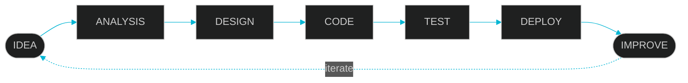

<!-- ═══════════════════════════════════════════════════════════
     GELSEN KRISTOVAN — DEVELOPER COMMAND CENTER
     Cari teks "GANTI" untuk menemukan semua placeholder link.
     ═══════════════════════════════════════════════════════════ -->

<!-- ───────────── 1. HERO ───────────── -->
<div align="center">


<br/>

`[ STATUS: ONLINE ]`

<a href="https://git.io/typing-svg">
  
</a>

<p>
  
  
  
</p>

<sub>Pelajar RPL yang sedang membangun kemampuan di dunia software development, web development, dan UI/UX.</sub>

</div>

<br/>

```bash
gelsen@developer:~$ whoami
Gelsen Kristovan

gelsen@developer:~$ role
RPL Student • Web Developer • UI/UX Enthusiast

gelsen@developer:~$ status
Learning • Building • Improving
█
```

<div align="center">
  
</div>


<!-- ───────────── 2. ABOUT ME ───────────── -->
## `> ABOUT ME`

<table>
  <tr>
    <td>

Saya siswa kelas XI Rekayasa Perangkat Lunak (RPL) di **SMK Bagimu Negeriku** yang tertarik dengan dunia teknologi, pengembangan website, desain antarmuka, dan software development.

Saya sedang belajar bagaimana sebuah ide bisa berkembang jadi produk digital yang tampilannya menarik, mudah dipakai, dan sistemnya jalan dengan baik.

Saya nggak cuma mau bisa bikin tampilan website, tapi juga paham bagaimana **struktur, logika, database, API, dan sistem backend** bekerja di balik sebuah aplikasi.

<p align="center"><code>Learn. Build. Break. Fix. Repeat.</code></p>

  </td>
  </tr>
</table>

<!-- ───────────── 3. WHAT IS RPL ───────────── -->
## `> WHAT IS RPL?`

**Rekayasa Perangkat Lunak (RPL)** adalah bidang yang mempelajari cara membuat software dari nol sampai bisa dipakai orang, bukan cuma soal nulis kode, tapi seluruh prosesnya.



<table>
  <tr>
    <td><b>01</b> Analisis Kebutuhan</td>
    <td><b>02</b> Perancangan Sistem</td>
  </tr>
  <tr>
    <td><b>03</b> UI/UX</td>
    <td><b>04</b> Pemrograman</td>
  </tr>
  <tr>
    <td><b>05</b> Database</td>
    <td><b>06</b> API</td>
  </tr>
  <tr>
    <td><b>07</b> Testing</td>
    <td><b>08</b> Debugging</td>
  </tr>
  <tr>
    <td><b>09</b> Deployment</td>
    <td><b>10</b> Maintenance</td>
  </tr>
</table>

<!-- ───────────── 4. TECH STACK ───────────── -->
## `> MY TECH STACK`

**Programming Languages**


**Frontend**


**Backend**


**Database**


**Mobile**


**UI/UX**


**Tools**


<!-- ───────────── 5. LANGUAGES I USE ───────────── -->
## `> LANGUAGES I USE`

```text
HTML        ████████████████░░  80%
CSS         ███████████████░░░  75%
JavaScript  ████████████░░░░░░  60%
PHP         ██████████░░░░░░░░  50%
Dart        ████████░░░░░░░░░░  40%
```

<sub>*Progress cuma visualisasi proses belajar, bukan klaim tingkat keahlian profesional.*</sub>

<!-- ───────────── 6. CURRENTLY BUILDING ───────────── -->
## `> CURRENTLY BUILDING`

<table>
  <tr>
    <td width="50%">
      <h4>01 — Web Development</h4>
      Membangun website modern menggunakan HTML, CSS, JavaScript, dan framework.
    </td>
    <td width="50%">
      <h4>02 — Backend Development</h4>
      Belajar membuat sistem backend, database, API, authentication, dan CRUD.
    </td>
  </tr>
  <tr>
    <td width="50%">
      <h4>03 — UI/UX Design</h4>
      Membuat interface yang bersih, modern, responsive, dan mudah digunakan.
    </td>
    <td width="50%">
      <h4>04 — Software Engineering</h4>
      Belajar memahami struktur aplikasi, debugging, version control, dan deployment.
    </td>
  </tr>
</table>

<!-- ───────────── 7. SELECTED PROJECTS ───────────── -->
## `> SELECTED PROJECTS`

<!-- GANTI: ubah LINK_REPO_... dengan URL repository masing-masing project.
     Ubah juga status project sesuai kondisi sebenarnya. -->

<table>
  <tr>
    <td width="50%" valign="top">
      <h3>STUDYPLANNER</h3>
      <p>Aplikasi untuk membantu mengatur jadwal belajar, target, dan kalender.</p>
      <p><b>Technology:</b><br/>HTML • CSS • JavaScript</p>
      <p>
        <br/>
        <a href="LINK_REPO_STUDYPLANNER"></a>
      </p>
    </td>
    <td width="50%" valign="top">
      <h3>E-VOTING SMK BAGIMU NEGERIKU</h3>
      <p>Sistem voting digital untuk pemilihan Ketua dan Wakil Ketua OSIS.</p>
      <p><b>Technology:</b><br/>HTML • CSS • JavaScript • Database</p>
      <p>
        <br/>
        <a href="LINK_REPO_EVOTING"></a>
      </p>
    </td>
  </tr>
  <tr>
    <td width="50%" valign="top">
      <h3>STOCK MANAGEMENT</h3>
      <p>Aplikasi sederhana untuk mengelola data stok barang.</p>
      <p><b>Technology:</b><br/>CRUD • Database • Web Development</p>
      <p>
        <br/>
        <a href="LINK_REPO_STOCK"></a>
      </p>
    </td>
    <td width="50%" valign="top">
      <h3>WASTE SORTING GAME</h3>
      <p>Game edukasi pemilahan sampah organik dan non-organik.</p>
      <p><b>Technology:</b><br/>HTML • CSS • JavaScript</p>
      <p>
        <br/>
        <a href="LINK_REPO_WASTE_GAME"></a>
      </p>
    </td>
  </tr>
</table>

<!-- ───────────── 8. DEVELOPMENT PROCESS ───────────── -->
## `> MY DEVELOPMENT PROCESS`

```text
01 THINK     →  pahami masalahnya dulu
      ↓
02 PLAN      →  tentukan fitur & prioritas
      ↓
03 DESIGN    →  wireframe, UI, alur pengguna
      ↓
04 CODE      →  ubah rancangan jadi program
      ↓
05 TEST      →  coba semua skenario
      ↓
06 DEBUG     →  cari tahu kenapa error, lalu perbaiki
      ↓
07 DEPLOY    →  rilis supaya bisa dipakai orang
      ↓
08 IMPROVE   →  dengar masukan, ulangi dari awal
```

> *Saya percaya bahwa membuat software bukan hanya tentang menulis kode, tetapi memahami masalah, merancang solusi, menguji hasil, dan terus memperbaikinya.*

<!-- ───────────── 9. GITHUB STATS ───────────── -->
## `> GITHUB STATS`

<div align="center">
  
  
  <br/>
  
</div>

<!-- ───────────── 10. BUILDING MY EXPERIENCE ───────────── -->
## `> BUILDING MY EXPERIENCE`

> *Setiap commit adalah bagian kecil dari proses belajar.*

<div align="center">
  
</div>

<!-- Snake animation: butuh workflow .github/workflows/snake.yml (ada di file terpisah).
     Gambar baru muncul setelah workflow dijalankan satu kali. -->
<div align="center">
  <picture>
    <source media="(prefers-color-scheme: dark)" srcset="https://raw.githubusercontent.com/gelsenxyz3/gelsenxyz3/output/github-snake-dark.svg" />
    
  </picture>
</div>

<!-- ───────────── 11. ROADMAP ───────────── -->
## `> MY ROADMAP`

```text
2026  ── RPL FUNDAMENTALS
│        HTML / CSS / JavaScript
│        Git & GitHub
│        UI/UX
│
▼
2027  ── FRONTEND + BACKEND
│        React
│        Laravel
│        REST API
│        Database
│
▼
NEXT  ── SOFTWARE ENGINEERING
         System Architecture
         Cloud
         Deployment
         Advanced Backend
```

<!-- ───────────── 12. DEVELOPER TERMINAL ───────────── -->
## `> DEVELOPER TERMINAL`

```bash
gelsen@smk-bagimu-negeriku:~$ npm run developer

> Initializing developer profile...

[████████████████████] 100%

> Loading skills...
> Loading projects...
> Loading experience...
> Loading motivation...

SYSTEM READY.
```

<div align="center">
  
</div>

<!-- ───────────── 13. QUOTE ───────────── -->
<br/>

<div align="center">

*"Code is not just something I write.*
*It is something I use to turn ideas into reality."*

<sub>— Gelsen Kristovan</sub>

</div>

<br/>

<!-- ───────────── 14. CONNECT ───────────── -->
## `> CONNECT WITH ME`

<!-- GANTI: isi link di bawah dengan milikmu sendiri -->
<div align="center">
  <a href="https://github.com/gelsenxyz3"></a>
  <a href="LINK_INSTAGRAM"></a>
  <a href="LINK_PORTFOLIO"></a>
  <a href="mailto:EMAIL_KAMU"></a>
</div>


